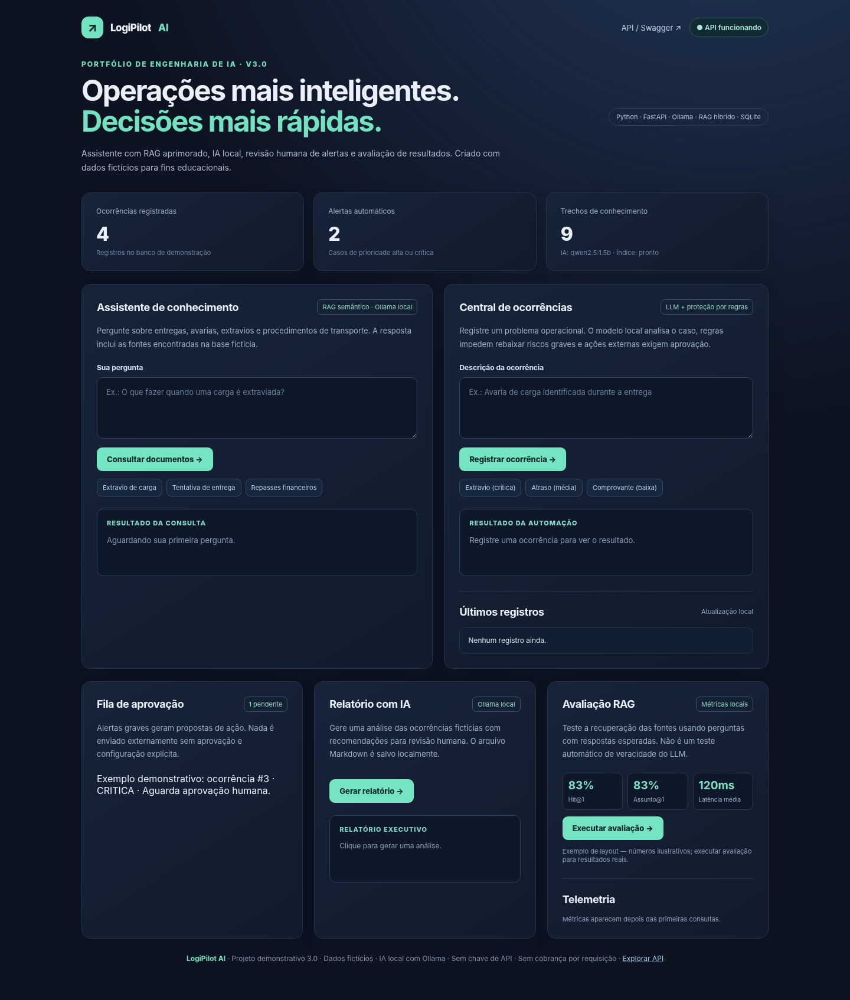
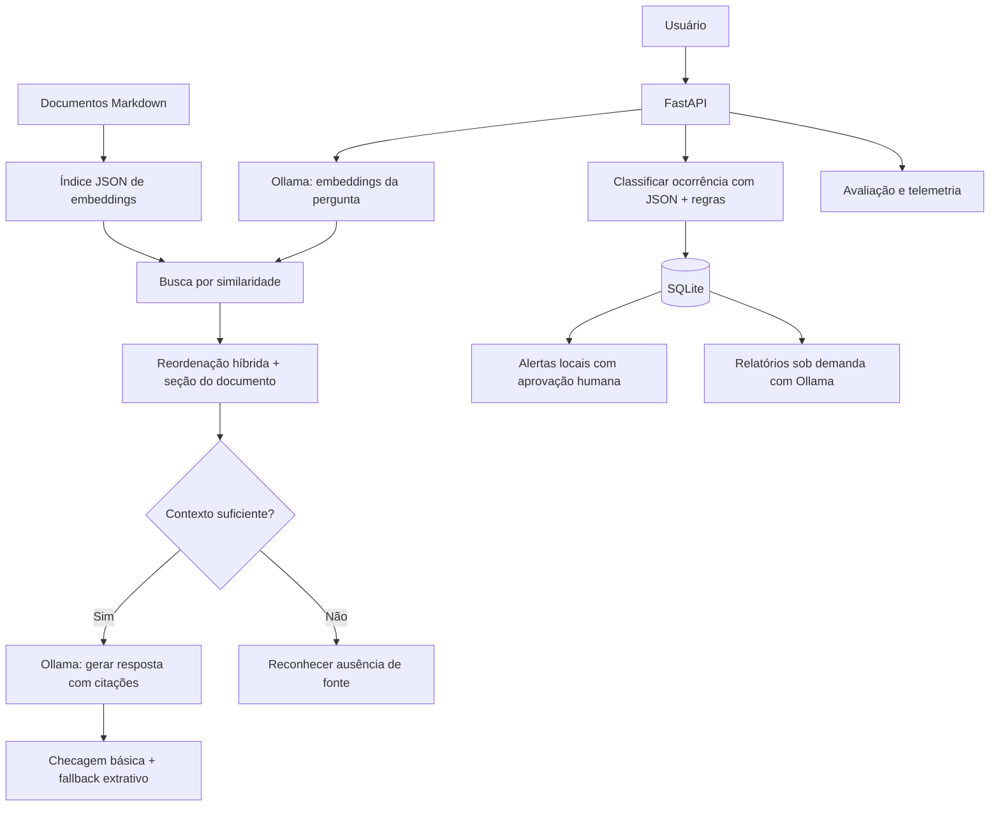

# 🚚 LogiPilot AI — Assistente RAG e automação logística

   

**Portfólio de AI Engineer**: assistente de operações logísticas usando **RAG híbrido com embeddings locais**, LLM para explicar procedimentos, classificação de ocorrências, aprovação humana de alertas, geração de relatórios e avaliação de recuperação. A base e os incidentes de exemplo são **inteiramente fictícios**.

> **Grátis para executar localmente:** sem chave, SDK ou créditos da API OpenAI; sem cobrança por requisição do Ollama. Downloads iniciais exigem internet; depois, modelos e embeddings são executados em `localhost`. Consumo de CPU/GPU, energia e disco é normal. Integrações externas são explicitamente desabilitadas por padrão.



*Imagem de prévia da interface. Os números e estados exibidos na captura são ilustrativos.*

## Apresentação rápida para recrutadores

**Problema:** informações de procedimentos logísticos estão dispersas; ocorrências graves exigem triagem e revisão antes de qualquer ação.

**Solução:** uma aplicação web construída com FastAPI, Ollama, RAG local (embeddings + TF-IDF + heurísticas transparentes), SQLite e painel de acompanhamento. Um fluxo separado gera relatórios e encaminha alertas críticos para aprovação humana. Os documentos e incidentes são **fictícios**.

**Demonstrações:** [Roteiro de 3 minutos](docs/DEMO.md) · [Arquitetura e decisões](docs/ARCHITECTURE.md) · [Estudo de caso](docs/CASE_STUDY.md) · [Resultados reproduzíveis](docs/RESULTADOS.md) · [Guia de publicação](GUIA-PUBLICACAO.md).

**Resultados que podem ser verificados sem Ollama:** 29 testes automatizados passaram na versão avaliada em 29/10/2026; no conjunto de seis perguntas fictícias, o recuperador **lexical/híbrido com regras** atingiu Hit@1 = 6/6 e Assunto@1 = 6/6. Isso **não mede** a qualidade factual das respostas do LLM nem substitui a avaliação com o Ollama real. Veja os comandos e limites em [Resultados](docs/RESULTADOS.md).

> **Transparência:** projeto de estudo desenvolvido com auxílio de IA. Antes de apresentá-lo como seu portfólio, revise o código, rode os testes no seu computador e registre quais partes você compreendeu, modificou e validou. Uma entrevista técnica pode explorar escolhas e limitações que não aparecem no painel.

**Tópicos sugeridos no GitHub:** `python`, `fastapi`, `ollama`, `rag`, `llm`, `embeddings`, `ai-engineering`, `automation`, `sqlite`, `portfolio`.


## Componentes da versão 3.0

| Módulo | Como funciona | Atenção |
|---|---|---|
| RAG aprimorado | Ollama `/api/embed`, índice JSON, similaridade cosseno, reordenação híbrida e filtro por seção/assunto | Reranking por **heurística explicável**: não usa um segundo modelo neural |
| Respostas com fontes | Ollama `/api/chat`, trechos `[1]`, `[2]` e fallback extrativo quando falha checagem básica | Ter citação **não prova** que cada afirmação é fiel à fonte |
| Classificação por IA | Ollama com saída estruturada JSON Schema, validação Pydantic e piso de prioridade baseado em regras | LLM pequeno pode falhar; nesse caso retorna classificação por regras |
| Ações revisáveis | Alerta local e fila de aprovação no SQLite para casos graves | Nenhuma ação externa ocorre automaticamente; webhook desabilitado |
| Relatórios com IA | Geração local sob demanda a partir dos incidentes, salva `.md` em `reports/` | Recomendações requerem avaliação humana |
| Métricas | Hit@1, Hit@3, Assunto@1 e latência em 6 casos fictícios; telemetria de consultas | **Não** mede factualidade, precisão geral ou desempenho em produção |

## Instalação / atualização no Windows

Se já estiver usando a 2.1, **leia primeiro [GUIA-INSTALACAO-V3.md](GUIA-INSTALACAO-V3.md)** para preservar seu `.env`, banco SQLite e índice de embeddings.

### Instalação nova

1. Instale o [Ollama para Windows](https://ollama.com/download/windows).
2. Faça download dos modelos (uma única vez):

```powershell
ollama pull qwen2.5:1.5b
ollama pull nomic-embed-text-v2-moe
```

3. Extraia o projeto; abra PowerShell na pasta `logipilot-ai` (onde está `requirements.txt`) e execute:

```powershell
py -3 -m venv .venv
.\.venv\Scripts\python.exe -m pip install -r requirements.txt
Copy-Item .env.example .env
.\.venv\Scripts\python.exe -m scripts.check_ollama
.\.venv\Scripts\python.exe -m scripts.build_embeddings
.\.venv\Scripts\python.exe -m uvicorn app.main:app --reload
```

4. Abra **http://127.0.0.1:8000** para o painel ou **http://127.0.0.1:8000/docs** para o Swagger.

Não é necessário ativar scripts do PowerShell: use o caminho direto `\.venv\Scripts\python.exe`.

## Fluxo do sistema



## Endpoints principais

| Método | Endpoint | Finalidade |
|---|---|---|
| `GET` | `/api/health` | Estado dos modelos e índice |
| `POST` | `/api/ask` | Consulta RAG, fontes e latência |
| `POST` | `/api/incidents` | Classificação LLM + regras e registro |
| `GET` | `/api/incidents` | Ocorrências |
| `GET` | `/api/actions` | Fila de propostas para aprovação |
| `POST` | `/api/actions/{id}/approve` | Aprovar uma proposta uma única vez |
| `POST` | `/api/actions/{id}/reject` | Rejeitar uma proposta |
| `POST` | `/api/reports/generate` | Relatório Markdown com Ollama local |
| `GET` | `/api/metrics` | Quantidade/latência/fallbacks |
| `POST` | `/api/evaluation/run` | Executar avaliação local do recuperador |
| `GET` | `/api/evaluation/latest` | Resultado mais recente da avaliação |

**Exemplo de requisição**:

```json
{"question": "Uma carga foi extraviada durante o transporte. O que fazer?"}
```

Consulte os detalhes dos esquemas via `/docs`.

## Testes e observabilidade

```powershell
.\.venv\Scripts\python.exe -m pytest -q
.\.venv\Scripts\python.exe -m scripts.evaluate_advanced --mode lexical
.\.venv\Scripts\python.exe -m scripts.evaluate_advanced --mode semantic
```

Os testes **não acessam serviços externos** e incluem migração do SQLite, classificação por LLM falso, rejeição de respostas sem citação, revisão humana e avaliação de recuperação. O teste de modelo real requer Ollama instalado no computador do usuário.

**Como interpretar as métricas:** `Hit@1` significa que a fonte/documento esperado apareceu primeiro; `Assunto@1` significa que o tópico da seção correspondeu ao esperado; `latência` mede o tempo médio de recuperação no teste. Um conjunto de seis exemplos **não generaliza** para documentos reais ou produção.

## Arquivos importantes

```text
app/
  knowledge.py       Carrega documentação, seções e busca TF-IDF
  semantic.py        Embeddings locais e índice versionado
  rag.py             Fusão de sinais e guarda-freio de assunto
  llm.py             Prompt RAG, citações e fallback extrativo
  intelligence.py    Classificação LLM com Pydantic + regras
  storage.py         SQLite + migração de base antiga
  reports_ai.py      Relatórios LLM local
  evaluation.py      Métricas de recuperação
  ollama_client.py   Cliente limitado a loopback
  main.py            FastAPI e endpoints
  static/index.html  Dashboard
knowledge/           Documentos fictícios
scripts/             Utilitários de indexação, avaliação e relatórios
tests/               Testes determinísticos offline
```

## Controles e limitações

- **Sem integração com OpenAI API.** Somente `AI_PROVIDER=ollama` ou `demo`, sem modelos de nuvem. URLs do Ollama são restritas a loopback.
- O `.env` e o banco de dados não são publicados no Git; também **não são incluídos** no ZIP entregue.
- Ações externas ficam desligadas com `ALLOW_EXTERNAL_WEBHOOK=false`; aprovação no painel altera só o registro local. Ao habilitar uma URL HTTPS e o opt-in manualmente, você assume as implicações de privacidade/custos do serviço escolhido.
- Os prompts não eliminam alucinações ou ataques de prompt injection, mesmo com fallback e filtros. Confirme recomendações em operação real.
- Não exponha a API na internet: **não há autenticação, autorização, rate limit ou isolamento entre usuários**. Execute em `127.0.0.1`.
- Os relatórios do GitHub Actions são **estáticos (sem Ollama)**. Verifique limites de minutos do GitHub Actions antes de habilitar workflows no repositório.

## Referências técnicas

- [Ollama — `/api/chat`](https://docs.ollama.com/api/chat)
- [Ollama — `/api/embed`](https://docs.ollama.com/api/embed)
- [Ollama — Structured Outputs](https://docs.ollama.com/capabilities/structured-outputs)
- [FastAPI](https://fastapi.tiangolo.com/)

Licença MIT · Projeto educacional · Dados fictícios.
