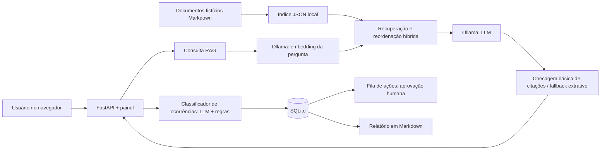

# Arquitetura, decisões e limites

## Visão geral

## Decisões técnicas

| Escolha | Razão | Limitação / alternativa |
| --- | --- | --- |
| **Ollama local** | Sem faturamento por token; processamento local | Desempenho depende da memória e CPU/GPU; modelo pequeno pode errar |
| **`nomic-embed-text-v2-moe`** | Vetores multilíngues para consultas em português | Exige download e indexação inicial; mudanças no corpus exigem reindexação |
| **TF-IDF + cosseno + heurísticas por seção** | Sinal lexical explicável combinado à busca semântica | As regras são específicas ao domínio; não são reranker neural treinado |
| **SQLite** | Facilita reprodução local, baixo custo operacional | Sem controle multiusuário robusto; não indicado para produção na forma atual |
| **FastAPI e Pydantic** | Validação, API REST documentada e testes | A aplicação não possui autenticação nem limitação de taxa |
| **Revisão humana de alertas** | Evita que decisões do LLM disparem ações externas sem revisão | O fluxo de aprovação local é demonstrativo, não integra um sistema corporativo real |
| **Fallback extrativo** | Quando a resposta gerada falha em checagens básicas, exibe fontes recuperadas | Não detecta todas as alucinações; uma citação pode acompanhar uma afirmação incorreta |

## Como funciona a busca

1. Carregar trechos e títulos de seção dos documentos Markdown fictícios.
2. Pré-calcular embeddings via Ollama e guardar o índice versionado localmente.
3. Gerar o embedding da pergunta no mesmo modelo.
4. Reunir candidatos semânticos e lexicais; deduplicar os trechos.
5. Reordenar por sinais de similaridade, TF-IDF e compatibilidade de assunto.
6. Fornecer até três trechos ao LLM, solicitar citações `[1]`, `[2]` e `[3]` e aplicar uma checagem conservadora.

As heurísticas resolvem alguns conflitos explícitos (por exemplo, extravio vs. avaria), mas não garantem generalização para novos domínios ou outros documentos.

## Segurança e escopo

- **Execução local:** bind padrão em `127.0.0.1`; não use `--host 0.0.0.0` em redes não confiáveis.
- **Sem segredos no Git:** `.env`, SQLite e índice vetorial local são ignorados; não publique dados reais.
- **Webhook externo desabilitado** por padrão (`ALLOW_EXTERNAL_WEBHOOK=false`). Aprovar na UI não implica envio externo enquanto estiver desabilitado.
- **Sem autenticação ou autorização:** este projeto não é serviço de produção. Casos reais exigiriam identidade, isolamento por usuário, auditoria e proteção de dados.
- **Prompt injection e alucinações:** documentos podem conter instruções maliciosas. As checagens atuais são básicas e não fornecem garantia de veracidade.
- **Custo:** não há integração paga de API no código. O hardware utiliza energia; workflows GitHub Actions têm regras próprias de cobrança/limites.

## Possíveis evoluções

- Avaliação de resposta com critérios de fidelidade/grounding, e casos adversariais.
- Comparação controlada entre recuperação lexical e semântica em corpus maior.
- Autenticação e testes de segurança antes de qualquer acesso remoto.
- Observabilidade de modelos, métricas de uso e logs com anonimização.
- Testes de carga com hardware explicitado e resultados reprodutíveis.
